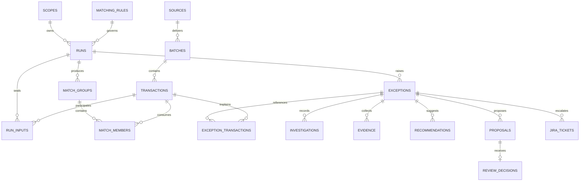

# Database relationships and implementation notes
SCHEMA.sql contains proposed executable DDL, not an applied migration. UUID primary keys are generated server-side. Records have stable source identities; changed source payloads create an ingestion conflict, never an overwrite. Run inputs seal the evaluated population. Match membership uniqueness prevents reuse inside scope; overlapping scopes require an explicit source-pair policy and lock before any write.

Audit logs point to affected resource IDs polymorphically; service validation establishes valid references. The outbox records external delivery intent within the originating transaction. Foreign keys establish identity, not authorization. Application checks must verify that evidence, proposals and recommendations belong to the same case; deploy DB triggers or constrained procedures as defense in depth.

Exact-v1 accepts one record from each side. Later one-to-many needs explicit bounded group rules, shared reference, currency/direction agreement, exact Decimal totals and unique consumption; no unrestricted subset search. Tolerance rules need approved fee policy and business-calendar date interpretation. They are intentionally absent from the initial engine.
