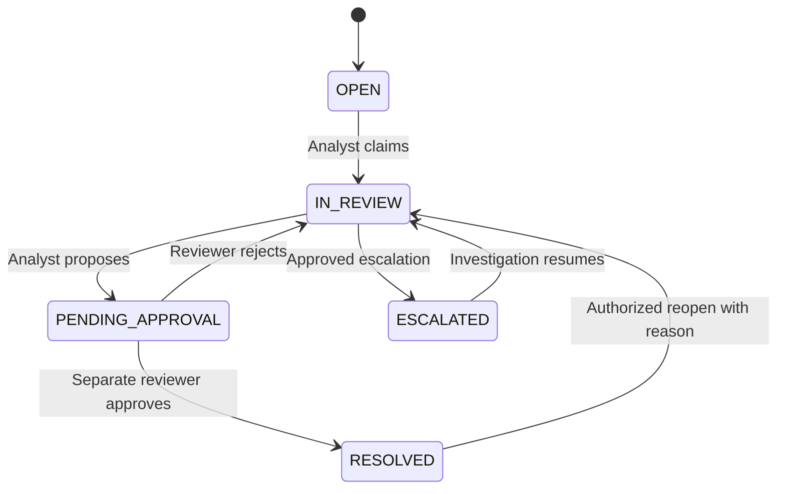
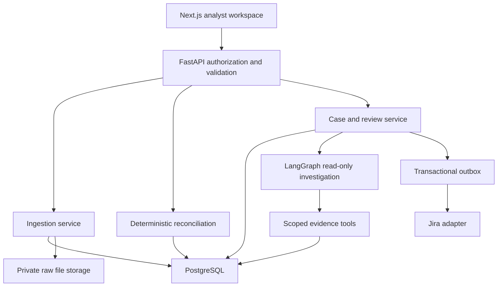

# Workflow and technical architecture

## Detailed reconciliation workflow
1. Configure source pair, currency, account perspective, business-date semantics and cutoff. Store immutable rule version.
2. Receive file and idempotency key; calculate SHA-256; enforce size/row limits; store private raw artifact and receipt.
3. Parse strings, validate all rows and collect errors. Normalize source-specific fields. Reject atomic batch if any error. Do not deduplicate identical monetary rows based on amount/date alone.
4. Commit batch and records with unique source record identities and audit event. Repeated identical delivery returns previous receipt; changed content with reused identity is a conflict.
5. Seal run membership from accepted batches in one scope. Lock scope while committing results. Run cannot consume arbitrary records from other source pairs.
6. Build candidate index by reference, business date, currency, direction and Decimal amount. Unique candidates on each side match. Repeated reference on either side is conservatively ambiguous in v0.1. Blank references cannot auto-match.
7. Classify unresolved records: duplicate identity, ambiguous reference, amount discrepancy, date discrepancy, missing source A/B or insufficient reference. If several explanations apply, retain structured evidence and one primary code; never claim a missing transaction solely because a date tolerance was not configured.
8. Commit groups, memberships, exceptions, metrics and audit atomically. DB uniqueness prevents double matching. Roll back whole run on conflict. Failed runs retain failure metadata, not partially published matches.
9. Analyst claims case, adds evidence and proposes a disposition (source correction requested, timing difference confirmed, duplicate confirmed). No imported transaction is edited.
10. Reviewer checks exact proposal version and evidence. Approval closes workflow only; ledger entries remain unchanged. Rejection records reason and returns case to investigation. Reopening requires manager/reviewer reason and event.
11. Optional approved escalation enters outbox; Jira worker sends with stable key, stores ticket identity and retries with backoff. External ticket closure cannot itself close financial exception.
12. Dashboard derives counts from committed results, with currency and cutoff. Audit export reconstructs imported record→run→rule→case→proposal→decision.

## State machine

SLA clock begins at creation; escalation does not reset it. Initial proposed SLA: high 4 business hours, medium 1 business day, low 3 business days. Business calendar and timezone must be configured before enforcement. Severity depends on configured amount thresholds and age, not an LLM score.

## Architecture

Modular monolith first: domain rules are Python functions, services control transactions, repositories own SQL, transport owns HTTP. PostgreSQL is authoritative; Pandas may help exploratory analysis but must not coerce money to floating point. SQL NUMERIC and Python Decimal share scale rules. No Redis or queue needed initially; a PostgreSQL outbox worker suffices when asynchronous integrations arrive. Next.js renders data and interaction; financial decisions run server-side.

## Concurrency and integrity
Use a scope row lock and unique run idempotency key. Commit run results atomically, enforce unique transaction consumption in scope and check run status. Proposal writes require expected case version and row lock. Reviewer identity differs from proposer. Every critical action writes audit inside the same transaction. Application role lacks UPDATE/DELETE on audit and accepted raw records; migrations use a separate role. External export provides stronger tamper evidence later.

## API contract (planned, except health)
POST /api/v1/batches (multipart; Idempotency-Key); GET /batches/{id}; POST /runs (sealed batch IDs and rule version); GET /runs/{id}; GET /exceptions (cursor filters); POST /exceptions/{id}/claim; POST /exceptions/{id}/proposals; POST /proposals/{id}/decisions; POST /exceptions/{id}/reopen; GET /audit; GET /metrics. Mutations require authenticated actor and reason where applicable. Errors: 401 unauthenticated, 403 forbidden, 409 stale/idempotency conflict, 422 invalid input, 413 too large, 503 dependency unavailable. Cursor responses have items and next_cursor. Monetary JSON values are strings. Run mutations return request and resource IDs. No request-supplied role is trusted.

## AI responsibility matrix (later release)
| Agent | Allowed inputs and output | Forbidden |
|---|---|---|
| Investigator | Case context → investigation questions | Ledger/case writes |
| Retriever | Scoped evidence IDs → cited records | Cross-case retrieval |
| Risk assessor | Rules and evidence → explained priority suggestion | Changing severity directly |
| Recommender | Verified facts → next-step proposal | Closure or Jira creation |
| Critic | Evidence bundle + proposal → pass/fail and unsupported claims | Fabricating citations |
Graph: retrieve→investigate→assess→recommend→verify→human. Bound iterations, cost and execution time; if verification fails, return insufficient evidence. Treat imported descriptions as untrusted data, not instructions. Store model/prompt versions, evidence hashes, tool traces, costs and verification outcomes. AI is not part of matching.
